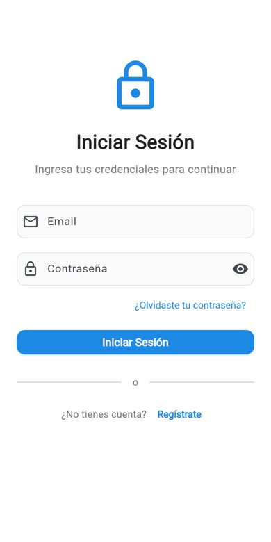

# Mi Ubicación · App Flutter con login y mapa

App móvil en **Flutter** con flujo completo de autenticación (splash, login, registro y cierre de sesión), pantalla principal con perfil y ajustes, y **mapa con la ubicación actual** del usuario.



## Funcionalidades

- **Splash** que verifica si hay sesión y redirige a login o al inicio.
- **Login y registro** con validación de formularios: formato de email, longitud de contraseña, confirmación y aceptación de términos.
- Servicio de autenticación (`AuthService`, singleton) con sesión en memoria. Está preparado para conectar **Firebase Auth**: las dependencias ya están en `pubspec.yaml` y los puntos de integración marcados en el código.
- Pantalla principal con navegación inferior, perfil y ajustes.
- **Mapa** (Google Maps) con la ubicación actual, permisos de ubicación y geocodificación de la dirección.

## Stack

Flutter 3 · Dart 3 · Material 3 · google_maps_flutter · geolocator · geocoding · permission_handler

## Cómo correrlo

```bash
flutter pub get
flutter run
```

Para el mapa en Android, agrega tu clave en `android/local.properties`:

```
MAPS_API_KEY=tu_clave
```

### Calidad

```bash
flutter analyze   # sin issues
flutter test      # pruebas del login
```

## Estructura

```
lib/
├── main.dart                    # tema, rutas y splash
├── services/auth_service.dart   # autenticación (singleton)
├── screens/auth/                # login y registro
├── screens/home/                # inicio, perfil, ajustes y mapa
└── widgets/custom_button.dart
```

## Autor

**[Brian Saavedra](https://github.com/briansaa)**
